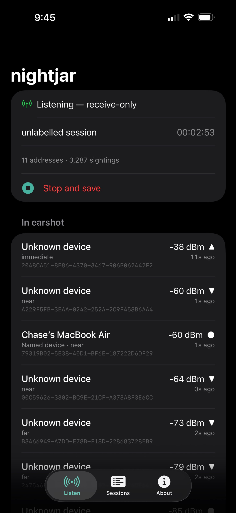

# nightjar

A passive Bluetooth Low Energy listening post.

Everything around you is gossiping in BLE advertisements — phones,
watches, earbuds, TVs, cars, tracker tags — each one broadcasting what
it is and how loud it is. Almost nobody listens. nightjar does: it
collects the advertisements, folds them into a registry of devices,
sees through the address rotation phones use to hide, and over time
learns the pattern of life of the space it sits in — including the
tag that keeps turning up wherever *you* go.

**Receive-only, by design.** nightjar never connects, never pairs,
never sends data. It only listens to what is already being shouted
([one honest footnote](#passive-and-active-scanning) about the radio
itself, below).

## On your phone

The listening post walks around, too. The `ios/` folder holds a native
iOS companion: the same receive-only ears in your pocket, with a live
"in earshot" list and session recording. It writes logs in the exact
JSONL format the Python side reads, so a session captured on the phone
feeds straight into `report` and `trackers` on the computer.

<p align="center"></p>

There is no App Store build. You install it the way it was built: open
the project in Xcode, sign it with your own Apple ID, and sideload
it — `ios/README.md` walks through it, including the honest caveats
(iOS shows per-phone UUIDs instead of hardware addresses, and Apple's
free signing expires after 7 days).

## Install

```
pip install .
```

For development:

```
pip install -e ".[dev]"
python -m unittest discover
```

No Bluetooth hardware handy, or just want to see it work? Skip
straight to the [demo](#demo).

## Listen

Listen until you stop it:

```
nightjar
```

Listen for a minute, saving everything:

```
nightjar scan --duration 60 --log sightings.jsonl --out summary.json
```

As devices appear you get a line each — address, signal, what it is
as far as its broadcasts say — and on exit a summary of who was here,
one row per *device* rather than per address, with the rotating
phones folded back together:

```
— 7 devices, 211 sightings; 1 rotated addresses —
DEVICE                       KIND                                 CLOSEST  SEEN  SIGNAL           WINDOW            NOTES
AirPods Pro                  AirPods Pro                         -42 dBm    61  ▇█▇▇▇▇▇▇▇▇▇▇▇▇ ● 20:42:31-20:43:33 by name + fingerprint
                             AirPods Pro: L 80% (in ear), R 90% (in ear), case 70%, lid open, white
Apple device (Nearby Info)   Apple device (Nearby Info)          -58 dBm    44  ▅▆▅▅▆▅▅▆▅▅▆▅▅▆ ● 20:42:31-20:43:33 14 addresses (rotates); by payload fingerprint
Find My device (AirTag-clas… Find My device (AirTag-class)       -66 dBm    30  ▄▄▅▄▄▅▄▄▄▄▅▄▄▄ ● 20:42:34-20:43:30 tracker-shaped
                             Find My network broadcast (separated from owner), battery medium
```

Sessions label themselves with where you're listening, detected from
the Wi-Fi network the host is on (the analysis commands use labels as
places). `--label home` overrides the detection when you want your own
word for a place; `NIGHTJAR_LABEL` and `NIGHTJAR_LOG` in the
environment set standing defaults for a post that always runs in the
same spot.

Add `--live` for the radar: a full-screen view, strongest signals on
top, each device with its range band, trend arrow, how long since it
was last heard, and a sparkline of its signal history, redrawn every
second. `--addresses` adds the raw per-address table to the summary,
`--json` turns the whole run into a stream of JSON events for other
programs, and `--adapter hci1` picks a radio on Linux.

### Passive and active scanning

A BLE scanner has two modes. In *passive* mode the radio only listens.
In *active* mode it answers each advertisement with a standard scan
request, which the device may answer with a scan response — that is
where many device names live. Scan requests carry nothing but the
scanner's own address, but they are transmissions, and "nothing is
sent" should mean nothing is sent.

So nightjar asks for passive scanning first and tells you when it
can't have it:

- **Windows** scans passively.
- **Linux** scans passively when BlueZ has its experimental features
  on (`Experimental = true` in `/etc/bluetooth/main.conf`, or
  `bluetoothd --experimental`); BlueZ's passive mode only reports
  advertisements that match a filter, so nightjar casts a wide net
  (common Flags values, the big makers' manufacturer prefixes, the
  tracker and beacon service UUIDs) rather than everything.
- **macOS** cannot scan passively at all; CoreBluetooth doesn't offer it.

When passive isn't available nightjar prints one line saying so and
falls back to active scanning. `--active` chooses active outright and
silences the notice (you'll hear more names); `--passive` refuses the
fallback and exits instead. The mode in force is recorded in every
session's log header.

## Watch

`scan` answers when you stop it; `watch` speaks when something
happens:

```
nightjar watch --log sightings.jsonl
nightjar watch --webhook https://discord.com/api/webhooks/...
nightjar watch --webhook https://ntfy.sh/my-topic --ignore "D4:61" --ignore "Chase's Watch"
```

It alerts — on the console, into the session log, and to a webhook if
one is configured (`--webhook` or `NIGHTJAR_WEBHOOK_URL`; Discord,
Slack and ntfy are recognized from the URL, anything else gets a JSON
body) — when a new device appears after a warmup, and when a
tracker-shaped device has stayed near you across several hours at
close range. Each alert fires once per device. Webhook delivery runs
on its own thread, so a slow endpoint never stalls the radio. Your own
tags and wearables match the tracker shape too: name them with
`--ignore` (an address prefix or a name, repeatable, or
`NIGHTJAR_IGNORE=D4:61,Chase's Watch`) and they stay quiet.

`--warmup`, `--tracker-min-minutes`, `--tracker-min-hours` and
`--tracker-min-rssi` tune the thresholds; `--live` works here too,
with the latest alerts pinned under the radar.

## Analyze

Pattern of life over everything you've logged — who is a regular, on
which days, in which places, at what hours (a 24-hour activity
profile per device), how close they usually get, and whose broadcasts
get decoded into plain language:

```
nightjar report sightings.jsonl
nightjar report logs/ --since 7 --place office --wide
nightjar report sightings.jsonl --json
```

Logs can be files, directories of files, or globs. `--since DAYS` and
`--place LABEL` narrow the sessions; `--wide` adds first/last seen,
usual days and average stay; `--min-sessions` hides the one-offs;
`--sort` reorders.

Hunt for a tag that is following you — tracker-shaped, turning up in
session after session, in more than one place, present at both ends
of a listening session, at close range. Suspects are reported with
their evidence and a confidence word:

```
nightjar trackers sightings.jsonl
nightjar trackers logs/ --ignore "D4:61" --json
```

And everything the logs know about one device — its sessions, places,
hours, signal, decoded details — by address prefix, name, kind or
identity key:

```
nightjar show "D4:61" sightings.jsonl
nightjar show airpods logs/
```

### How a suspect is scored

An identity is a *candidate* only if it is tracker-shaped: unnamed,
and broadcasting like a standalone tag — a Find My accessory in its
separated-from-owner format (not one riding with its owner, which
broadcasts differently), a Google Find My Device network beacon, a
Tile, a SmartThings Find tag. Phones that rotate by design (Exposure
Notification, for instance) are never candidates. Then:

| Evidence                                                        | Points |
| --------------------------------------------------------------- | -----: |
| present in several sessions (`--min-sessions`, default 2)       |     +2 |
| seen under more than one place label                            |     +2 |
| near you for many hours, adding up presence per session (`--min-span-hours`, default 8) | +1 |
| present near both the start and the end of some session         |     +1 |
| stayed at close range (median RSSI ≥ `--min-rssi`, default −80) |     +1 |

Five points make a suspect (`--threshold`); seven is "strong". The
bar is set so that a tag which merely *lives* somewhere you go — a
colleague's keys on the same desk every day — can't reach it on
persistence alone (sessions + hours + range is 4). It takes a second
place, or riding along from the start of a session to its end, to tip
over. Evidence, not proof: a tag you never listened near leaves no
trace here, and your own tags match the shape perfectly.

## Demo

No Bluetooth hardware handy? Two ways to try it. A live fake
neighbourhood — a few resident devices, tags of three persuasions,
and one phone that rotates its address the way real phones do:

```
nightjar --simulate --duration 20
nightjar --simulate --live
```

Or a whole week-in-the-life: labelled home and office sessions over
several days, residents in each place, a coworker's Tile that never
leaves the office, a coworker's AirTag riding with its owner — and one
separated AirTag that is wherever the listener is. `demo` writes the
log and runs `report` and `trackers` on it:

```
nightjar demo --days 3
nightjar show "Find My" nightjar-demo.jsonl
```

## What it can read

Identification is from broadcast metadata only — no connection, ever.

- **Apple Continuity** (manufacturer data 0x004C): the message chain is
  parsed in full. Proximity Pairing resolves AirPods and Beats to their
  model, both buds' battery and charging state, which are in-ear, the
  case battery and lid, and colour (the layout OpenPods established
  from captures). iBeacons decode UUID, major, minor and calibrated
  power. Nearby Info reports the device's state code (only the
  verified "watch worn & unlocked" code gets a label; the rest are
  shown numerically rather than guessed at). Nearby Action names what
  a device is inviting (Wi-Fi password share, Apple Pay, setup…), and
  Tethering Source gives an iPhone's hotspot battery and signal bars.
- **Find My** (AirTags, lost Apple devices): the fixed-format
  separated broadcast, documented in the AirGuard research, with
  battery from its status byte — and the short form an accessory sends
  while its owner is nearby, which is not the shape of a tracker.
- **Google**: Fast Pair earbuds (model id while discoverable),
  Eddystone beacons (UID, URL, telemetry, EID), and the Find My Device
  network's tracker beacons that share Eddystone's UUID.
- **Microsoft**: the Connected Devices Platform beacon every Windows
  machine, Xbox and Surface sends names its device class outright;
  Swift Pair announces a device in pairing mode with its display name.
- **Tile**, **Samsung SmartThings Find**, **Exposure Notification**,
  Ruuvi environmental sensors (temperature, humidity, pressure), and
  a curated table of makers by company id and of well-known service
  UUIDs for everything else.

Rotating phones are re-identified by a fingerprint of the stable core
of their broadcasts. The fingerprint is *epoch-scoped*: a phone
rotates those bytes along with its address on a schedule, so
correlation is strong inside an epoch and fades across epochs — that
fade is the privacy design working, and nightjar labels the basis of
every identity honestly. Where the radio says so (Linux, Windows), the
address type itself is recorded: a resolvable private address is one
that will rotate.

## The log

JSON Lines, one file per post (append-only) or per session. A run
writes a header, a sighting per advertisement, any alerts, and a
footer:

```json
{"type": "session", "session_id": "61523c0f1d29", "label": "home", "label_source": "manual", "started_at": 1792028551.45, "scan_mode": "passive", "format": 1, "nightjar_version": "2.0.0"}
{"type": "sighting", "seen_at": 1792028551.85, "address": "C1:2A:9D:44:10:7E", "name": "AirPods Pro", "rssi": -43, "manufacturer_data": {"76": "0719010e202a9807..."}, "service_uuids": [], "tx_power": null, "service_data": {"0000feaa-...": "40..."}, "address_type": "random"}
{"type": "alert", "seen_at": 1792028701.03, "kind": "new-device", "text": "New device appeared: ...", "identity_key": "fp:0b3f1aaf321f", "label": "...", "device_kind": "...", "address": "...", "data": {}}
{"type": "session_end", "session_id": "61523c0f1d29", "ended_at": 1792028555.52, "sightings": 11}
```

`manufacturer_data` keys are company ids as decimal strings, values
the payload without the company id, lowercase hex; `service_data` is
keyed by full lowercase UUID. `service_data`, `address_type`,
`scan_mode` and the footer are nightjar 2 additions — logs from 1.x
(and from the [iOS companion](ios/README.md)) load unchanged, headerless
0.1 logs are split into sessions on gaps, and a corrupt line is
skipped and counted rather than fatal.

## Platform notes

- **macOS** — works out of the box, but CoreBluetooth hides real MAC
  addresses: devices appear under per-host UUIDs instead, and only
  active scanning is available. Wi-Fi-based place detection may
  return a redacted SSID unless the terminal has Location permission
  (nightjar also tries `system_profiler`); a manual `--label` always
  works.
- **Linux** — needs BlueZ; the process needs Bluetooth capability
  (run as root, or grant `CAP_NET_RAW`/`CAP_NET_ADMIN` to the Python
  binary). Passive scanning needs BlueZ experimental features.
- **Windows** — works out of the box, passively.
- **iPhone** — a native companion app in [`ios/`](ios/README.md) puts the
  listening post in your pocket and writes the same log format, so a
  session recorded on the phone feeds straight into `report` and
  `trackers` on the Mac.

## The build, in levels

1. **Collection** — log every advertisement. ✅
2. **Registry** — fold sightings into devices with histories. ✅
3. **Identification** — read *what* a device is from its broadcast
   format and see through address rotation. ✅
4. **Pattern of life** — presence over days and sessions: regulars,
   days present, usual hours, places heard. ✅
5. **Counter-detection** — flag the tag that keeps turning up near
   *you*: tracker-shaped, persistent across sessions and places,
   present at both ends of a session, at close range — the
   unwanted-tracking pattern the Apple/Google spec describes, scored
   with the evidence shown. ✅
6. **The post stands guard** — `watch` mode with once-per-device
   alerts to the console, the log and a webhook. ✅

## Scope

nightjar observes broadcast advertisements — signals devices send to
everyone, on purpose. Run it in spaces where you have a right to
listen. It does not intercept connections or private traffic, because
it cannot: it only hears what is shouted.

## License

AGPL-3.0 — see `LICENSE`.
